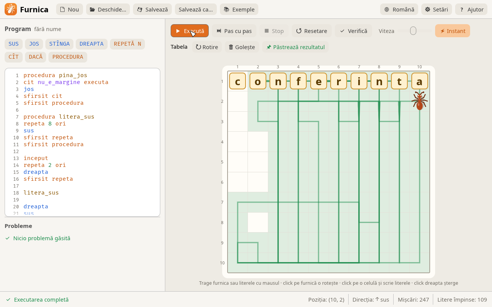
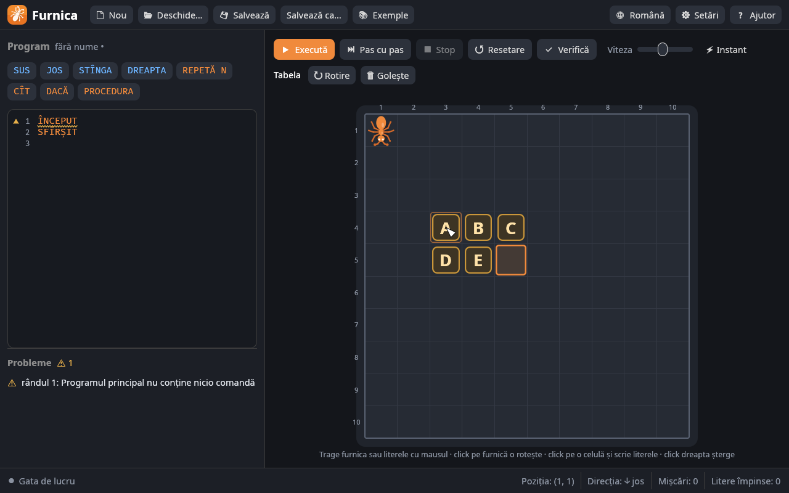
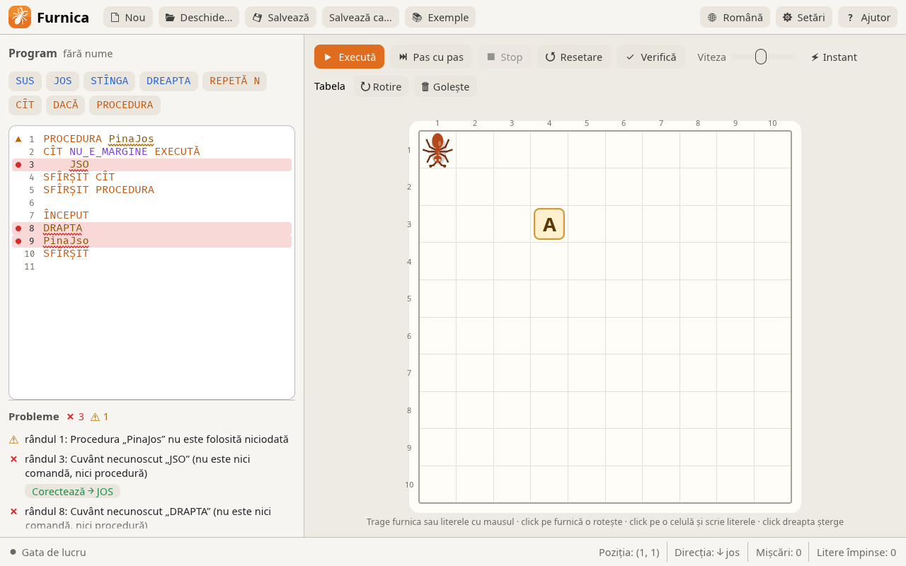

<div align="center">

<p align="center">
  
</p>


**The “Furnica” (Ant) executor for learning algorithms — students write a program with simple commands, and the ant runs it on a table of letters, pushing the letters out of its way.**

[](LICENSE)
[](Cargo.toml)
[](https://github.com/emilk/egui)
[](#windows-7-32-and-64-bit)
[](packaging/linux/)
[](#macos)

[**Quick start**](#quick-start) · [The language](#the-language) · [Code analyzer](#code-analyzer) · [File format](#file-format) · [Releases](../../releases) · [Issues](../../issues)

[Română](README.md) · **English** · [Русский](README.ru.md)

</div>

<br />

A **Rust** rewrite of the original “Furnica” program (Ant v2.00, 1999), used
in schools in Moldova and Romania. `.ant` files from the old version open and
run unchanged. *Furnica* is Romanian for “ant”.



## Quick start

Ready-made packages are on the [Releases](../../releases) page:

```
furnica-<version>-linux-x86_64.AppImage         # Linux, a single file
furnica-<version>-linux-x86_64.deb              # Ubuntu / Debian / Mint
furnica-<version>-linux-x86_64.tar.gz           # Linux, archive
furnica-<version>-macos-universal.dmg           # macOS (Apple Silicon and Intel)
furnica-<version>-windows-x64.msi               # Windows 10/11, 64-bit, installer
furnica-<version>-windows-x86.msi               # Windows 10/11, 32-bit, installer
furnica-<version>-windows-x64-portable.zip      # Windows 10/11, 64-bit
furnica-<version>-windows-x86-portable.zip      # Windows 10/11, 32-bit
furnica-<version>-windows7-x86-portable.zip     # Windows 7, 8, 10, 11 (32- and 64-bit)
SHA256SUMS.txt                                  # checksums
```

On each platform:

- **Windows:** the `.msi` installs Furnica into *Program Files* with a Start
  menu shortcut, and `.ant` files open with a double click (for many
  computers: `msiexec /i furnica-*.msi /qn`). Without installing: unzip the
  archive and run `Furnica.exe`;
- **Linux:** make the AppImage executable and run it
  (`chmod +x furnica-*.AppImage && ./furnica-*.AppImage`); on Ubuntu / Debian
  you can install the `.deb` (`sudo apt install ./furnica-*.deb`): Furnica
  appears in the menu and `.ant` files open with a double click;
- **macOS:** open the `.dmg` and drag `Furnica.app` onto *Applications*. It is
  not signed with an Apple certificate, so on first launch: right-click →
  *Open* (on macOS 15+: *System Settings → Privacy & Security → Open Anyway*),
  see [macOS](#macos).

### From source

Install [Rust](https://rustup.rs), then in this folder:

```sh
cargo run --release                  # start the application
cargo run --release -- program.ant   # open a file directly
```

The executable ends up in `target/release/` (`furnica.exe` on Windows) and can
be copied to other computers: it needs no other files. On Windows the ant icon
is embedded in the `.exe` automatically. Rendering uses OpenGL 2.0, so it also
works on older school lab computers.

---

## What's new compared to the original

| | |
|---|---|
| **Interface** | light and dark theme, new logo and icon; interface in Romanian, Russian and English |
| **The ant** | vector-drawn: sharp at any size, turns smoothly and moves its legs as it walks |
| **Editor** | line numbers, syntax highlighting, buttons that insert commands (a procedure is placed before `BEGIN` automatically) |
| **Running** | smooth animation, the current line highlighted, the ant's path drawn on the table; step by step, pause, adjustable speed or instant |
| **Analyzer** | the program is checked as you type, with suggested fixes ([details](#code-analyzer)) |
| **Blocks** | can be nested freely (in the original `REPEAT` could not contain another `REPEAT`, nor `WHILE` another `WHILE`) |
| **The table** | edited directly on it, from 3 × 3 to 20 × 20 cells ([details](#editing-the-table)) |
| **Files** | the program, table and settings are kept between launches; files open by drag & drop or from the command line |

### Editing the table



- **the ant** is moved by dragging (the target cell turns green or red), and a
  click on it turns it;
- **letters** are typed from the keyboard, like text: click a cell and type,
  the cursor moves to the next cell by itself (Backspace, Delete, arrows,
  Enter, Esc);
- letters are moved by dragging; dropped on another letter they swap places,
  and dragged off the table (or right-clicked) they are deleted;
- after a run the starting table stays unchanged; **Keep result** makes the
  resulting table the new starting table.

---

## The language

Keywords can be written in English, Romanian or Russian (see the
[table below](#keywords-in-three-languages)); here they are in English.

| Command | What it does |
|---|---|
| `UP`, `DOWN`, `LEFT`, `RIGHT` | moves the ant one cell; a letter in the way is pushed |
| `BEGIN … END` | the main program |
| `REPEAT N TIMES … END REPEAT` | repeats N times |
| `WHILE condition DO … END WHILE` | repeats while the condition is true |
| `IF condition THEN command1 ELSE command2` | branching (`ELSE` is optional) |
| `PROCEDURE name … END PROCEDURE` | defines a procedure (before `BEGIN`) |
| `name` | calls the procedure |
| `// …` | comment |

Conditions: `BORDER` (the ant faces the edge of the table) and `NOT_BORDER`.
The ant faces the direction it last moved in (at the start: the direction
saved in the file, which the **Rotate** button changes).

The ant cannot leave the table, cannot push a letter over the edge and cannot
push two letters standing one after another. In any of these cases the program
stops with an error, and the spot is marked red on the table.

### Keywords in three languages

They can be written in any of the languages, with or without diacritics — the
very words from the `romana.lng`, `engleza.lng` and `rusa.lng` files of the
original program.

| Română | English | Русский |
|---|---|---|
| `SUS JOS STÎNGA DREAPTA` | `UP DOWN LEFT RIGHT` | `ВВЕРХ ВНИЗ ВЛЕВО ВПРАВО` |
| `ÎNCEPUT SFÎRȘIT` | `BEGIN END` | `НАЧАЛО КОНЕЦ` |
| `REPETĂ ORI` | `REPEAT TIMES` | `ПОВТОРИ РАЗ` |
| `CÎT EXECUTĂ` | `WHILE DO` | `ПОКА СДЕЛАЙ` |
| `DACĂ ATUNCI ALTFEL` | `IF THEN ELSE` | `ЕСЛИ ТОГДА ИНАЧЕ` |
| `PROCEDURA` | `PROCEDURE` | `ПРОЦЕДУРА` |
| `E_MARGINE NU_E_MARGINE` | `BORDER NOT_BORDER` | `КРАЙ НЕ_КРАЙ` |

### Keyboard shortcuts

| Key | Action |
|---|---|
| **F5** | run / pause |
| **F6** | step |
| **Esc** | stop |
| **F7** | check |
| **Ctrl+N / Ctrl+O / Ctrl+S** | new / open / save (⌘ on macOS) |

---

## Code analyzer



The program is analyzed on every change (this can be turned off in
*Settings*; then analysis runs with **Check** / F7). The analyzer doesn't stop
at the first mistake, it finds them all:

- wrong words get a wavy underline (red = error, yellow = warning), and the
  line gets a marker next to its number; hovering shows the explanation;
- the **Problems** list under the editor shows all errors and warnings; a
  click takes the cursor to the word;
- for misspelled words a fix is suggested (“Did you mean RIGHT?”), applied with
  the **Fix** button — for procedure names too;
- a program with errors doesn't start; warnings don't block running.

| Kind | What is detected |
|---|---|
| **Errors** | words that are neither commands nor procedures; unknown conditions; `REPEAT` without a number; blocks left open or closed wrongly (`END WHILE` instead of `END REPEAT`); stray `END`/`ELSE`; missing command after `THEN`; missing or duplicate `BEGIN`; procedures defined twice or written inside the main program; text after `END` |
| **Warnings** | unused procedures; empty blocks; `REPEAT 0 TIMES`; `WHILE` loops that don't move the ant (may run forever); procedures that call themselves without stopping; empty main program |

---

## Compatibility with the original

The rules were taken from `furnica.exe` (Delphi 3): the forms in its resources
and the machine code of the commands (the old program was not run). With these
rules the original examples build exactly the words they are meant to:
“conferinta” and “svi99” on the first row (checked by the tests).

Decisions made where the old behavior was wrong or undocumented:

- **`BORDER` to the left and right is fixed.** In the original, after a move
  to the right the *left* edge was checked (and vice versa), so
  `WHILE NOT_BORDER DO RIGHT` took the ant off the table. Up and down worked
  correctly, and the original examples only use `DOWN` in loops, so they run
  the same;
- a `*` on the ant's cell in the file is just the ant's marker (the old
  program writes it that way too), not a letter;
- on an error the ant stays in place but faces the direction it tried to go,
  as in the original;
- `THEN` and `DO` may be omitted, and `NOT BORDER` is accepted as
  `NOT_BORDER`; `DO name` at the start of a line calls the procedure.

Furnica 3 saves in the same format, but the old program only understands
keywords without diacritics (`INCEPUT`, `SFIRSIT`, `STINGA`…), 10 × 10 tables
and non-nested blocks; compatibility in that direction has not been tried with
`furnica.exe`.

---

## File format

```text
Ant executor file
[table description]
1 10          ant position: column, row (from 1)
3             direction: 1 down, 2 left, 3 up, 4 right
2 9 i         letters: column, row, letter
1 10 *        the ant's cell
666 666 *     end of the table
procedura …   the program, up to the end of the file
```

Tables of a size other than 10 × 10 also have a `[size <columns> <rows>]` line
after the first line. Old files (Windows-1250 or Windows-1251) are detected
automatically; new ones are saved as UTF-8 with CRLF.

---

## Windows 7 (32 and 64-bit)

A normally built `.exe` requires Windows 10+ (a Rust requirement since version
1.78). For school labs with Windows 7 there is a separate build, made on Linux
with:

```sh
packaging/windows7/package.sh   # result: dist/release/furnica-<version>-windows7-x86-portable.zip
```

The script installs Rust nightly into `.cache/` and downloads what it needs;
from the system it only needs `curl`, `7z` and the 32-bit MinGW compiler
(`mingw-w64-gcc` on Arch, `gcc-mingw-w64-i686` on Debian/Ubuntu). The archive
runs on Windows 7, 8, 10 and 11, 32- and 64-bit, without installing and without
extra Windows updates:

- it uses `msvcrt.dll` (present on every Windows 7), not UCRT, which on
  Windows 7 needs update KB2999226;
- the `combase.dll` in the archive (3.5 KB) forwards a function that newer
  Rust libraries look for there, but which on Windows 7 lives in `ole32.dll`;
  on Windows 8+ it is ignored;
- the `soft-gl` folder contains Mesa (software OpenGL). If the graphics card
  has no OpenGL 2.0 driver (“Standard VGA” driver, virtual machines), the
  program restarts itself with Mesa. Slower, but it works. It can be forced
  with `Furnica.exe --software-gl`;
- this build only lacks screen reader support (that library needs
  Windows 8+). In the code this is the `accessibility` feature, on by default
  in the other builds.

It is the same recipe as for Cangurul 3. **Note:** this build has not yet
been started on a real Windows 7.

---

## macOS

The disk image `furnica-<version>-macos-universal.dmg` contains `Furnica.app`,
a single program for Macs with Apple Silicon (M1…M4) and with Intel, from
macOS 10.13 up. It can only be built on a Mac (for releases, on the GitHub
Actions macOS runner):

```sh
packaging/macos/package.sh   # result: dist/release/furnica-<version>-macos-universal.dmg
```

The app only has an ad-hoc signature, not one from an Apple Developer
certificate, so Gatekeeper blocks it on first launch. Open it with
right-click → *Open*, or once from Terminal:

```sh
xattr -dr com.apple.quarantine /Applications/Furnica.app
```

Shortcuts use ⌘ instead of Ctrl. **Note:** this build compiles for both
processors but has not yet been started on a real Mac.

---

## Code structure

| File | Contents |
|---|---|
| `src/lang.rs` | lexer, error-tolerant parser and compiler |
| `src/check.rs` | semantic analysis: warnings, procedures, suggested fixes |
| `src/vm.rs` | the virtual machine that executes one move at a time |
| `src/world.rs` | the table, the letters, the ant and the pushing rules |
| `src/antfile.rs` | reading and writing `.ant` files, old encodings |
| `src/table_edit.rs` | table editing rules: dragging, swapping, typing |
| `src/ant.rs` | the vector-drawn ant (smooth turning, stepping legs) |
| `src/app.rs` | the graphical interface (egui / eframe) |
| `src/i18n.rs` | interface texts in Romanian, Russian and English |
| `src/software_gl.rs` | restarting with software OpenGL (Mesa) on Windows |
| `examples/` | the original examples (`conferinta`, `svi99`) and new ones |
| `assets/` | fonts, the icons (`icon.py` redraws them from `src/ant.rs`, including `furnica.icns` for macOS), `banner.py` for the README banner (`python3 assets/banner.py FURNICA -o docs/assets/furnica-banner.png`) |
| `packaging/` | AppImage, `.deb` and archive for Linux, `Furnica.app` for macOS, `.msi` and archives for Windows 10/11, the Windows 7 archive |

The original program is kept for reference in the `Furnica/` folder (ignored
by git).

---

## Releases

The version lives in a single place, `Cargo.toml`, and is changed with
`packaging/version.sh set 3.1.0`. Releases are **automatic**: on a push to
`main` with a version not yet published, GitHub Actions builds the packages
for all platforms and publishes the release. A push with the same version only
runs the tests. Details (in Romanian) in [`docs/releasing.md`](docs/releasing.md).

## Tests

```sh
cargo test
```

The tests check the language, the file format, the pushing rules, running the
examples (with the exact result of the original ones) and the interface: they
press the real buttons, drag the ant and the letters and type on the table,
without a window. With `FURNICA_SHOTS=<folder> cargo test` they also save
screenshots (the ones in `docs/assets/` were made this way).

## License

Furnica 3 is free software, distributed under the
[GNU General Public License, version 3](LICENSE) or, at your option, any later
version.
